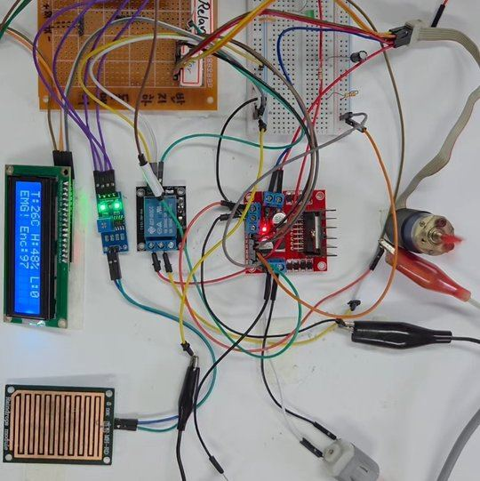
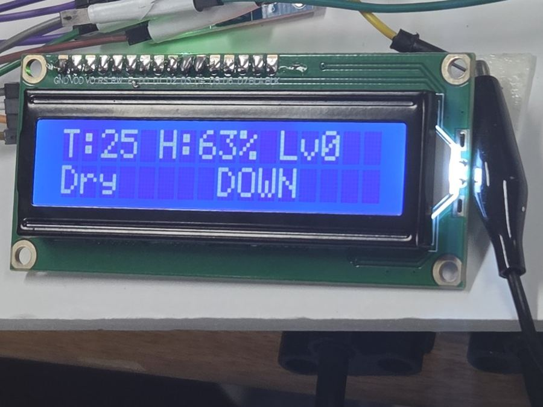
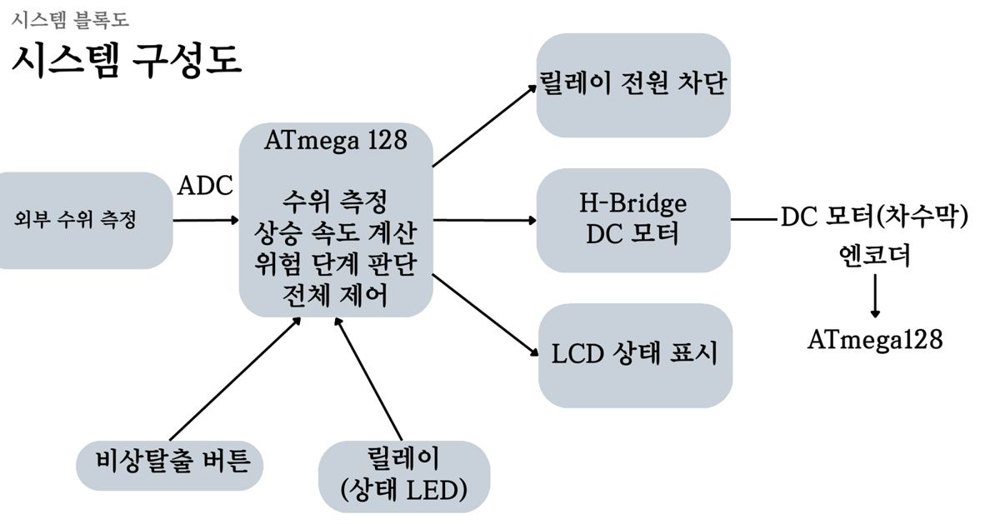
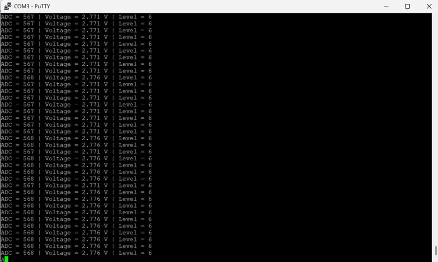
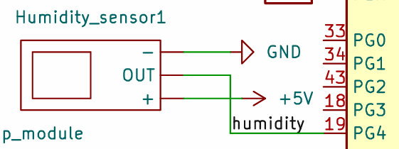
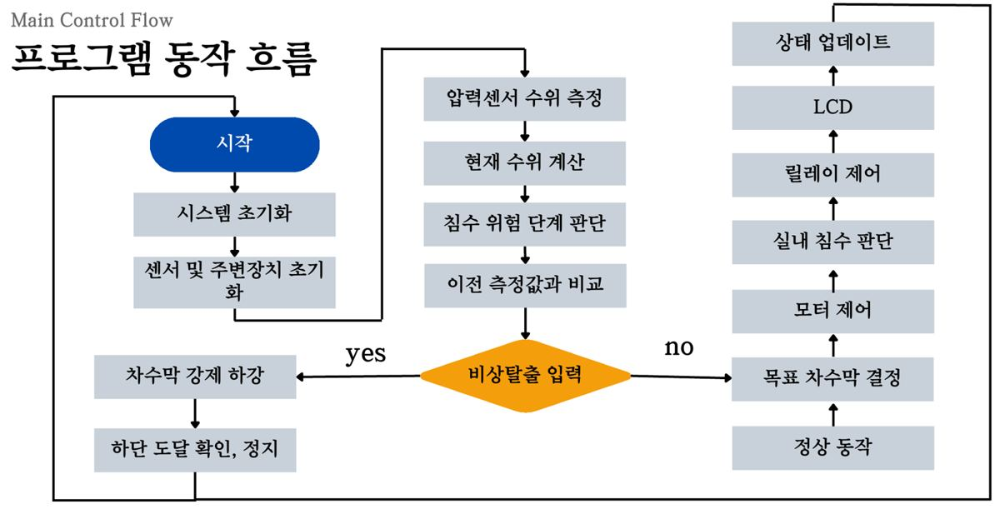
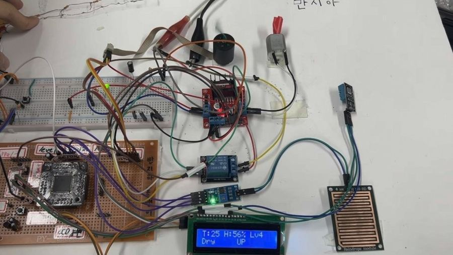
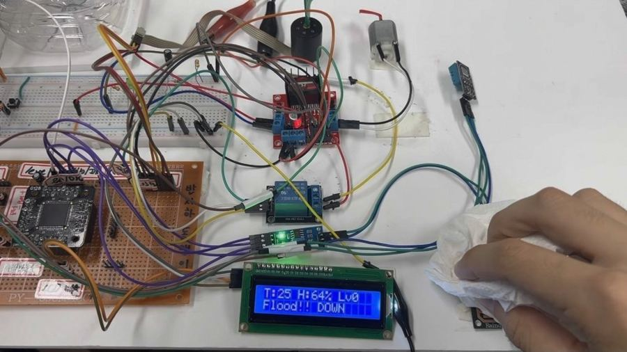
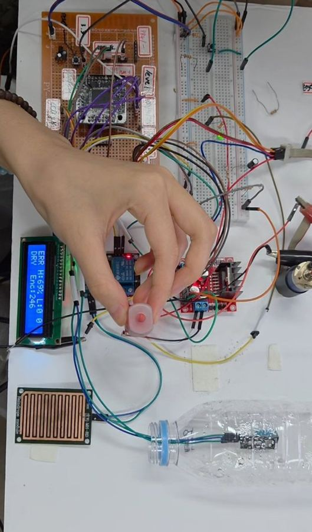

# AVR 레지스터 기반 완충 제어형 자동 침수 방지 시스템

> **2026 COSS 차세대반도체 MCU 응용 경진대회** 예선 출품작 · 팀 **반지하 청년단** (4인)
> HAL이나 Arduino 라이브러리 없이 ATmega128 **레지스터 수준**(bare-metal)으로 구현

  
  

## 개요

반지하 주택 침수 사고에서 착안했습니다. 단순히 수위만 감지하는 데서 그치지 않고,

- 실외 **수위를 5단계로 측정**해 위험 단계에 따라 **차수막(DC 모터)을 자동으로 올리고 내리며**
- 실내로 물이 새면 **릴레이로 전원을 차단**해 감전 같은 2차 전기 사고를 막고
- **비상탈출 버튼**을 누르면 자동 제어보다 우선해 차수막을 강제로 내립니다.
- 침수 위험이 없는 평상시에는 **습도에 따라 환기 팬을 제어**합니다.

## 시스템 구성

| 기능 | 부품 | 사용한 MCU 주변장치 |
| --- | --- | --- |
| 실외 수위 측정 | 전극식 수위 센서 | ADC0 (10-bit) |
| 실내 누수 감지 | 빗물 센서 SZH-SSBH-022 | ADC2(PF2) + 디지털 입력 PF3 |
| 온습도 측정 | DHT11 | GPIO(PG4) 단선 프로토콜 직접 구현 |
| 차수막 구동 | DC 모터 + TB6612FNG H-Bridge + 엔코더 | Timer1 PWM(OC1A/PB5), GPIO(PA0~PA2), INT4 |
| 환기 팬 | DC 팬 | Timer1 PWM(OC1B/PB6) |
| 전원 차단 | 1채널 릴레이 SZH-EK082 | GPIO(PA3) |
| 상태 표시 | 16x2 I2C LCD (PCF8574, 0x27) | TWI (I2C) 직접 구현 |
| 비상탈출 | 푸시 버튼 | 외부 인터럽트 INT7(PE7) |
| 디버깅 | PC (PuTTY) | USART1, 9600 bps 8N1 |

## 회로도

KiCad로 설계한 전체 회로도입니다.

| 센서부 (빗물 센서·수위) | 전원 제어부 (릴레이·LED) |
| --- | --- |
|  |  |
| **구동부 (TB6612FNG · 차수막 모터 · 환기 팬)** | **온습도 센서 (DHT11)** |
|  |  |

## 동작 흐름

제어 우선순위는 **비상탈출 > 침수 대응 > 일반 동작(환기)** 입니다.

### 1. 수위 5단계 판정

전극식 수위 센서의 출력을 ADC로 읽고, 실제로 물을 단계별로 채워가며 측정한 값으로 임계값을 정했습니다.

| ADC 값 | < 483 | < 512 | < 559 | < 615 | 그 이상 |
| --- | --- | --- | --- | --- | --- |
| 수위 단계 | Lv0 | Lv1 | Lv2 | Lv3 | Lv4 |

- ADC 기준 전압 AVCC(5 V), 분주 128 → ADC 클럭 125 kHz, 변환 시간 약 104 µs

### 2. 차수막 상태 머신 (완충 제어)

물결이나 노이즈 때문에 모터가 떨리지 않도록 **6상태 FSM**으로 만들었습니다.

~~~
DOWN ──(Lv3 이상 1초 연속)──▶ RISING ──(엔코더 2000 도달 or 2초)──▶ HOLD_UP(2초 대기) ──▶ UP
 ▲                                                                                     │
 └── HOLD_DOWN(1.5초 대기) ◀──(엔코더 0 도달 or 2초)── FALLING ◀──(Lv2 이하 1초 연속)──┘
~~~

- **연속 판정**: 조건이 10회(약 1초) 연속일 때만 상태를 바꿔 물결에 의한 오동작 차단
- **히스테리시스**: 올라가는 조건(Lv3 이상)과 내려가는 조건(Lv2 이하)에 1단계 차이
- **이중 종료 조건**: 엔코더 목표에 도달하거나 2초가 지나면 정지 → 엔코더가 고장 나도 모터가 무한히 돌지 않음
- **HOLD 완충**: 움직인 직후 일정 시간 모터를 강제로 멈춰 관성·수위 출렁임에 의한 즉시 반대 동작 방지

### 3. 실내 누수 감지와 전원 차단 (내 담당)

  

- 빗물 센서의 **아날로그(ADC2 < 500)와 디지털(PF3 LOW)** 중 하나만 감지돼도 침수로 판단
- 침수 시 릴레이(PA3)를 끊어 실내 콘센트·조명 전원을 차단하고, 환기 팬도 정지
- LCD 2행에 `Flood!!` 표시

### 4. 습도 기반 환기 팬 제어 (내 담당)

  
  

| 습도 | 팬 PWM (OCR1B) |
| --- | --- |
| 80% 이상 | 120 |
| 70% 이상 | 90 |
| 60% 이상 | 60 |
| 60% 미만 | 정지 |

- Timer1 하나로 2채널 PWM: OC1A = 차수막 모터, OC1B = 환기 팬 (Fast PWM 8-bit, 분주 64 → 976.6 Hz)
- 과전류·과속 방지를 위해 팬은 120, 모터는 110으로 상한을 둠

### 5. DHT11 단선 통신 직접 구현 (내 담당)

라이브러리 없이 GPIO 비트 조작과 µs 지연으로 구현했습니다.

- 시작 신호: 출력으로 전환해 20 ms LOW → 30 µs HIGH → 입력(내부 풀업)으로 전환
- 비트 판별: HIGH 시작 후 35 µs 시점에 샘플링해 HIGH면 1, LOW면 0
- 수신 중에는 엔코더·버튼 인터럽트가 타이밍을 흐트러뜨리지 않도록 `cli()`, 끝나면 즉시 `sei()` (차단 시간 4~5 ms)
- 체크섬과 범위(≤100)를 검사해 실패하면 직전 값을 유지 → 표시와 팬 제어가 튀지 않음

### 6. 비상탈출

- 버튼은 INT7 하강 에지 인터럽트. ISR에서는 플래그만 세우고 처리는 메인 루프에서 수행
- 매 루프 PE7 레벨도 직접 읽어 에지를 놓치거나 채터링이 생겨도 감지
- 비상 시퀀스: 팬·릴레이 차단 → LCD `EMERGENCY!!!` → 엔코더 0점까지 차수막 하강(최대 2초) → 3초 정지 → 상태 초기화

### 7. LCD 표시

~~~
T:25 H:63% Lv2       ← 온도, 습도, 수위 단계
Flood!! UP...        ← 침수 여부 + 차수막 상태
~~~

- PCF8574 I2C 백팩을 4비트 모드로 직접 구동 (HD44780 초기화 시퀀스 구현)
- 매번 16자 전체를 덮어써서 LCD 클리어 명령 없이 잔상 제거

## 결과

- 메모리: Flash **4,458 B** (3.4%), SRAM **147 B** (3.6%) → ATmega128 128 KB / 4 KB 안에서 여유 있게 동작
- 부품비: **52,162원**

## 개선할 점

- 압력센서의 정밀한 수위 보정으로 측정 오차 개선
- 다양한 강우·침수 조건에서 수위 상승속도 기준값 최적화
- 차수막 모터의 정밀 위치제어 알고리즘 개선
- 실제 전기설비를 고려한 릴레이·차단부 안전성 검증
- 실제 반지하 환경을 고려한 방수·방진 설계, 배수 시스템 연계

## 내 역할

**실내 침수 감지, 전원 차단, 평상시 환경 모니터링** 담당

- 빗물 센서(아날로그 ADC + 디지털 입력)로 실내 침수 감지
- 릴레이로 침수 시 실내 전원 차단
- DHT11 온습도 측정(단선 프로토콜 직접 구현), 습도에 따른 환기 팬 PWM 제어
- I2C LCD에 온습도, 수위 단계, 차수막 상태 표시
- 설계 문서와 실제 보드가 다른 부분을 디버깅으로 바로잡음
  - 크리스털 8 MHz → 실제 16 MHz
  - UART 포트 USART0 → 실제 USART1

ATmega128 레지스터 제어는 빛돌(BITDOL) 동아리 교육과정에서 익혔습니다. 학습 기록: [atmega128-study](https://github.com/yjh030418/atmega128-study)

## 개발 환경

`ATmega128 @ 16 MHz` `C (avr-gcc)` `Microchip Studio` `STK500` `PuTTY` `KiCad`

## 팀 (반지하 청년단)

| 이름 | 역할 |
| --- | --- |
| 강채린 | 회로 설계, 기본 회로 납땜 |
| **김희진** | 실내 침수 감지, 전원 차단, 환경 모니터링 |
| 오현택 | 실외 수위 측정, 차수막(DC 모터) 제어, 비상 탈출 스위치 |
| 이다은 | SW |
